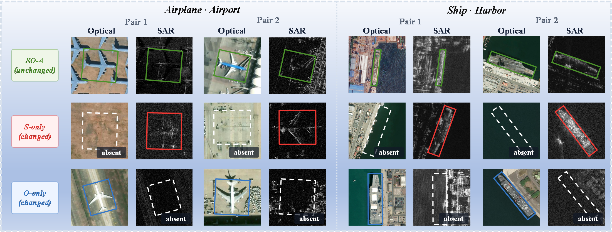
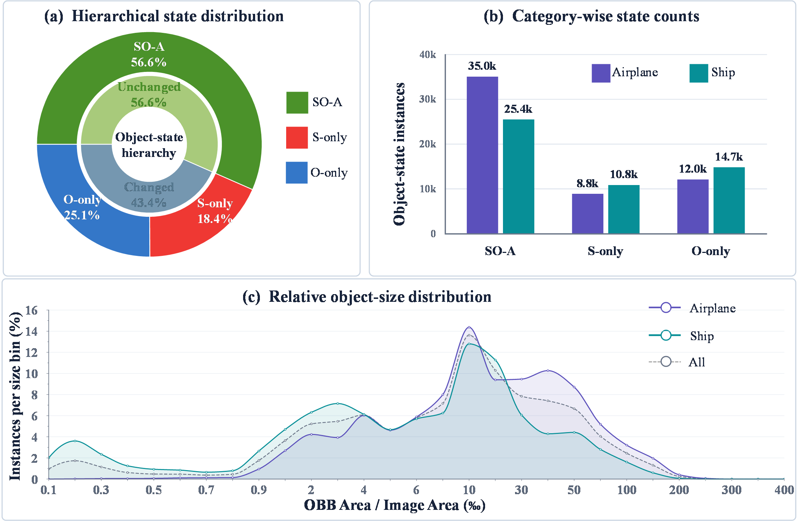
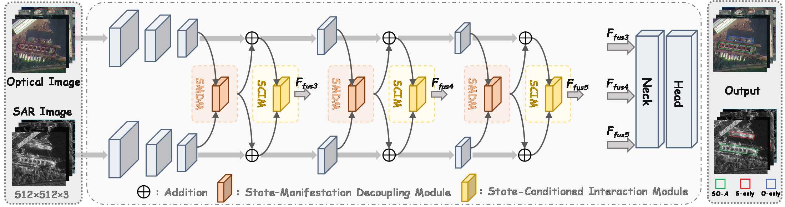

# MSOCD-160K & DASO-Det

**Multi-Source SAR–Optical Object-Level Change Detection**

Official implementation and dataset information for *Multi-Source SAR–Optical Object-Level Change Detection: A Benchmark Dataset and Unified Framework*.

**Authors:** Fanlong Meng, Fengli Xue, Kaiwei Li, and Xiangyang Qi.

## Overview

MSOCD-160K supports oriented object detection and cross-observation change recognition from asynchronous SAR–optical image pairs. The benchmark includes two object categories (airplane and ship) and three change labels:

| Label | Definition |
| --- | --- |
| **SO-A** | Spatially associated objects in both observations (Unchanged) |
| **S-only** | Objects observed only in SAR (Changed) |
| **O-only** | Objects observed only in optical imagery (Changed) |

The detection task uses **six joint classes** (two object categories × three change labels).



## Dataset

MSOCD-160K contains **143 scene pairs**, **21,481 paired 512 × 512 image patches**, and **167,117 OBB annotations** across the SAR and optical modalities. Optical sources include GF-2, GF-7, Jilin-1, and Google Earth; SAR sources include GF-3, Umbra, ICEYE, and Capella.

| Split | Scene pairs | Paired patches |
| --- | ---: | ---: |
| Train | 100 | 15,008 |
| Test | 43 | 6,473 |
| **Total** | **143** | **21,481** |

The split is performed at the scene-pair level. The 167,117 count refers to modality-specific OBB annotations.



### Availability

The **full dataset and pretrained checkpoints will be released after paper acceptance**. The repository currently provides the implementation, dataset format, and run scripts.

### Data format

```text
MSOCD-160K/
├── images/
│   ├── train/
│   └── test/
├── imagesSAR/
│   ├── train/
│   └── test/
└── labels/
    ├── train/
    └── test/
```

Optical images, SAR images, and label files share corresponding relative filenames. Each label follows the YOLO-OBB format:

```text
class_id x1 y1 x2 y2 x3 y3 x4 y4
```

Coordinates are normalized to `[0, 1]`. Class IDs are:

| ID | Class | ID | Class |
| ---: | --- | ---: | --- |
| 0 | `plane_SO-A` | 3 | `ship_SO-A` |
| 1 | `plane_S-only` | 4 | `ship_S-only` |
| 2 | `plane_O-only` | 5 | `ship_O-only` |

The network input consists of **optical RGB and SAR three-channel images** (six channels in total). Grayscale SAR imagery is read as three channels.

## Method

DASO-Det is built on a dual-branch YOLO11-OBB backbone with two components:

- **SMDM:** Complementary frequency-domain diagnostics and gated residual feature calibration.
- **SCIM:** Shared and directional feature modeling with state-conditioned interaction.



Four configurations are provided: `baseline`, `smdm`, `scim`, and `daso-det`. All use six detection classes and 512 × 512 paired inputs. The default SMDM parameters are **β = 0.25** and **α = 0.10**.

## Installation

Install a compatible PyTorch/torchvision build for your CUDA environment, then run:

```bash
git clone https://github.com/meng0505/MSOCD-160K.git
cd MSOCD-160K
python -m pip install -e .
```

The repository includes a modified Ultralytics runtime required for paired SAR–optical inputs and DASO-Det modules.

## Usage

**Check the dataset**

```bash
python scripts/check_dataset.py --data-root /path/to/MSOCD-160K --check-image-sizes
```

**Train**

```bash
python scripts/train.py --data-root /path/to/MSOCD-160K --model daso-det --device 0
```

Default settings: 512 × 512 inputs, batch size 32, 200 epochs, SGD, initial learning rate 0.01, and seed 0. Replace `daso-det` with `baseline`, `smdm`, or `scim` for ablation configurations. Checkpoints are saved under `runs/train/<model>/weights/`.

**Evaluate**

```bash
python scripts/val.py --data-root /path/to/MSOCD-160K --weights runs/train/daso-det/weights/best.pt --split test --device 0
```

**Predict**

```bash
python scripts/predict.py --weights runs/train/daso-det/weights/best.pt --source /path/to/MSOCD-160K/images/test --device 0
```

**Profile model complexity and speed**

```bash
python scripts/profile.py --model all --imgsz 512
python scripts/profile.py --model daso-det --device 0 --timing
```

FPS measures batch-1, FP32 network forward passes. FLOPs are estimated as twice the profiled THOP MACs; FFT and some element-wise operations are not fully counted in this estimate.

## Citation

Please cite the accompanying manuscript if you use MSOCD-160K or DASO-Det. The final citation will be added after publication; current metadata is provided in [CITATION.cff](CITATION.cff).

## License

The implementation retains the [AGPL-3.0 license](LICENSE) and builds on [Ultralytics YOLO](https://github.com/ultralytics/ultralytics) and [YOLOFuse](https://github.com/meng0505/YOLOFuse-main-change). Source imagery remains subject to its respective data-use terms.
